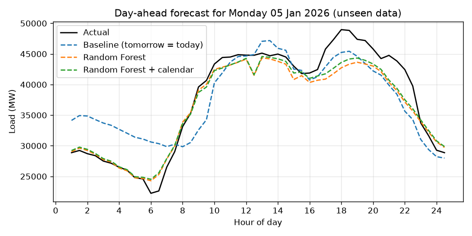

<div align="center">

  <h1>UK Electricity Demand Forecast</h1>

  <p>
    Predicts todays national electricity demand from yesterdays load
  </p>

<p>
<a href="LICENSE">
    
  </a>
  <a href="https://github.com/Onafuwadav/uk-electricity-demand-forecast/actions/workflows/daily-forcaster.yml">
    
  </a>
</p>

<h3>
  <a href="https://onafuwadav.github.io/uk-electricity-demand-forecast/">See today's forecast</a>
</h3>
</div>


## About the Project

Demand data for every half-hour settlement period is pulled from the Elexon BMRS API and cleaned
(duplicates removed, days with too many gaps dropped, small gaps filled). Each day is paired with the
next, and calendar features are added: day of the week, bank holidays, the Christmas period, and time
of year as sin/cos so the seasons wrap round smoothly at New Year. Ridge regression, Random Forest and
Extra Trees are compared against a "tomorrow = today" baseline.

Started as University of Nottingham coursework, then rebuilt with live API data, calendar features and
time-ordered validation.

### Tech Stack

[![Python][python-badge]][python-url] [![scikit-learn][sklearn-badge]][sklearn-url] [![pandas][pandas-badge]][pandas-url] [![NumPy][numpy-badge]][numpy-url]

## Getting Started

### Installation
```bash
git clone https://github.com/Onafuwadav/uk-electricity-demand-forecast.git
cd uk-electricity-demand-forecast
pip install -r requirements.txt
```

### Run
```bash
python src/train.py                                   # fetches the data, trains and evaluates every model
python src/fetch_elexon.py 2024-01-01 2025-01-01      # fetch a different date range
```

## Results


| Model | Load values only | With calendar features |
|---|---|---|
| Baseline  | 3,951 MW | |
| Ridge | 3,213 MW | 2,882 MW |
| Random Forest | 3,071 MW | 2,854 MW |



<details>
  <summary>Do the weather and school holidays help?</summary>
Trained on 2025 and tested on every day of 2026 up to mid November (322 days)

| Features | RMSE |
|---|---|
| Baseline | 2,760 MW |
| Calendar | 2,008 MW |
| Calendar + holidays | 2,004 MW |
| Calendar + weather | 1,824 MW |
| **Calendar + holidays + weather** | **1,817 MW** |

Weather cuts the error by about 9%. School holidays barely change it

</details>


## Live forecast

Every night at 3am UK time, a GitHub Actions job
([`daily-forecast.yml`](.github/workflows/daily-forcaster.yml), [`src/live.py`](src/live.py)):

- Fetches yesterday's demand and weather
- Scores the forecast it made yesterday against what actually happened
- Generates todays forecast and publishes to the
   [results page](https://onafuwadav.github.io/uk-electricity-demand-forecast/)
- On the 1st of the month, trains a new model on the latest year, replacing live if more accurate over a month

The live model adds the weather forecast averaged over five large GB cities, from [Open-Meteo](https://open-meteo.com/) and approximate England school holidays to the calendar features. and records everything it records is in [`live/`](live/)

## Contact

David Onafuwa: [LinkedIn](https://www.linkedin.com/in/david-onafuwa) · [Donafuwa@outlook.com](mailto:Donafuwa@outlook.com)

## Acknowledgements

- Elexon BMRS Insights API `ATL` dataset, used under the [BMRS Data Licence](https://www.elexon.co.uk/bsc/data/balancing-mechanism-reporting-agent/copyright-licence-bmrs-data/).
- Weather from [Open-Meteo](https://open-meteo.com/) (CC BY 4.0).


<!-- Tech stack badges -->
[python-badge]: https://img.shields.io/badge/Python-3776AB?style=for-the-badge&logo=python&logoColor=white
[python-url]: https://www.python.org/
[sklearn-badge]: https://img.shields.io/badge/scikit--learn-F7931E?style=for-the-badge&logo=scikitlearn&logoColor=white
[sklearn-url]: https://scikit-learn.org/
[pandas-badge]: https://img.shields.io/badge/pandas-150458?style=for-the-badge&logo=pandas&logoColor=white
[pandas-url]: https://pandas.pydata.org/
[numpy-badge]: https://img.shields.io/badge/NumPy-013243?style=for-the-badge&logo=numpy&logoColor=white
[numpy-url]: https://numpy.org/
